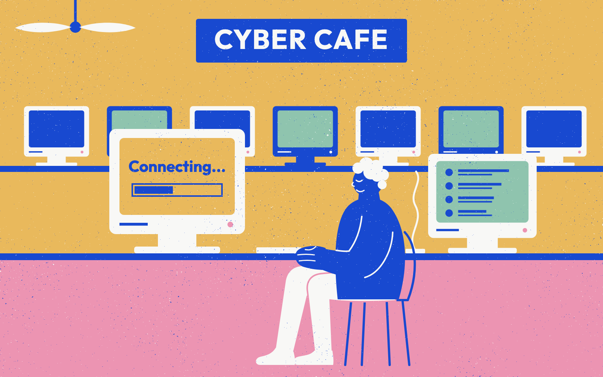
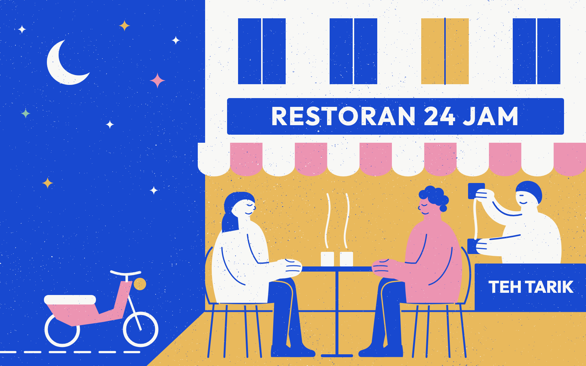

## I: You Remember the Internet?

As I was mindlessly doomscrolling through a feed of people I didn’t know (and some I don't care about), a thought hit me.

**When was the last time the Internet actually surprised me?**

Honestly, it's been a while.

Now, am I a millennial? Yes, so I've personally witnessed the gamut of the Internet's evolution. And I remember it as a very different kind of digital landscape. It was a time before algorithms and blue checks, and before the whole world became an open-concept boutique where everything is for sale.

If a Gen Z is reading this, they’re probably rolling their eyes over their oatmilk matcha lattes, whispering to themselves, *“Oh, look, another elder mourning the nineties.”*

Well, hand me my bifocals and call me unc, because there's no way you'll convince me that the Internet wasn't more magical and thrilling back then. And oh, honey, how fabulous the mess used to be.

It felt just like the wild west. A frontier to be explored. A vast, lawless terrain that somehow kept on expanding. It didn’t offer convenience; it demanded *effort*. You didn’t just wake up and fall into a stream of content. You had to *dial in*. You had to listen to that screeching, metallic mating call of a 56k modem, waiting with bated breath just to see if the world was on the other end of the line.

You had to search. You had to dig. The places you gathered at? All had high friction. From obscure message boards with draconian moderators and cryptic chat rooms, to personal blogs where people typed out raw HTML just to make their text blink in neon pink. Everything demanded investment, and most of it not monetary. \
\
I couldn't help but think about my early days exploring the Internet. You see, for me, a computer wasn’t simply sitting on a desk  in my room, always ready to be switched on. I had to scrape together pocket money, walk down to some dimly lit, slightly smoky cyber cafe, and pay by the hour. I remember sitting there, heart pounding, discreetly looking up obscure passions I dared not admit to at school. For me, that passion was manga and music videos banned by the government.

Sure, it wasn't a perfect scenario. But it made everything more beautiful. Back then every minute mattered. Every click was an intentional, desperate reach for something outside of my small world.

## II: 404-Curiosity Not Found

You could say part of it was because I was young and full of wide-eyed innocence. With one clumsy click of a mouse, my world broke open. I was talking to strangers in places I’d only read about in my second-hand books, swapping secrets with souls I would never touch. It was chaotic and unregulated; filled with potential, opportunities and discoveries.  \
\
Maybe that's why the walled-garden Internet we have right now feels so jarring.

Now, it’s a velvet-roped lounge where everyone has to show ID, pay a cover charge, and endure targeted ads for Kim K's shapewear. Want to read a thoughtful piece of writing? Pay up. Want to look at a photograph? Let five conglomerates harvest your eye movements so they can pitch you a designer serum you don't need. Like one little thing? Congratulations, darling. You have earned a lifetime pass to an echo chamber where the next ten thousand videos will be nothing but the same thing in different formats. All served up as reheated nachos that somehow still manage to keep you docile, primed, and swiping until your thumbs go numb.

> We don’t explore; we are fed.

It’s no longer an adventure. It’s a spectator sport. We don't explore; we are fed. And in this endless buffet of same-y content, I wonder, did the algorithm choke our curiosity, or did it also kill serendipity?

You already know how much I side-eye algorithms. To me, they only feed (get it?) into what people already believe and like. With every scroll, we are trained to become starved for more dopamine hits, filled with more anxiety and grievance because outrage and anxiety keep us watching.

That's how serendipity dies.

We used to stumble into delightfully bizarre rabbit holes, quirky personal web pages, obscure music forums, blogs written by eccentric romantics who had nothing to sell. Now, everyone is their own publicist. Everyone is hawking an aesthetic, monetising their weekend, and trading genuine affection for an impression count.

> “A million mini worlds instead of one big universe.”

Don't get me wrong. I'm not saying there are zero discoveries to be made nowadays. But the boundaries of our exploration only shift every few scrolls. The tragic irony is that we carry the entire sum of human knowledge in the palm of our hands, yet we feel smaller than ever. The modern feed doesn't expand our horizons. It’s a funhouse mirror, trapping us in our own neuroses, our biases, reflecting our deepest insecurities back at us dressed up as "personalised content." It's moving inwards rather than expanding; it's become a million mini worlds instead of one big universe. That's why it feels claustrophobic and suffocating.

## III: Terms and Conditions Apply

And that’s when the darker thought crept in.

What if the digital paradise we hold with such precious nostalgia was not taken from us?

What if our current cage was the blueprint all along?

We love to romanticise the birth of cyberspace, but before Silicon Valley slapped pastel branding and stock options onto it, the foundation of the net was ARPANET. And who paid for that? The US Department of Defense. It’s the ultimate Scooby-Doo unmasking: you yank off the shiny tech-utopia mask, and it's the Pentagon standing there in combat boots, smiling villainously.

Think about it. If you wanted to manage a restless, questioning global population, what better way than to give them an infinite digital pacifier? Give them enough outrage to keep their adrenaline pumping, enough distraction to keep them from looking up, and enough vanity metrics to make them care more about their digital reflection than their real-world neighbours. Divide them into neat little algorithmic tribes, turn their communities into captive markets, and just like that... Nobody is organising. Nobody is rebelling. Everyone is just refreshing the feed.\
\
Okay, maybe that's veering too close to tinfoil hat territory. I really should stop going to the weird corners of the Internet.\
\
But we don't need a conspiracy to see the reality of social engineering. Didn't Snowden reveal in 2013 that the NSA *was* pulling user data from big US tech companies through PRISM? And if you look hard enough, you'll find a few more things that can raise eyebrows. Even if all of this is disputable, you can't argue that once ads paid for everything, keeping us hooked and angry was fair game for business and governments alike.

## IV: Connections Lost

There is absolutely no point in pining over the old Internet. We can’t bring it back any more than I can squeeze into the skinny jeans I wore five years ago without dislocating a hip. The ship has sailed. The frontier has been paved, franchised, and turned into a shopping concourse. We live *here* now.

And yet, sitting there with the faint blue glow reflecting off my skin, I had to stop and ask myself:

**What if the thing I'm mourning isn’t the Internet at all?**

What if what we’re really starving for is the permission to be curious? The thrill of genuine exploration? The sacred, messy, unpredictable magic of real community? The more I think about it, the more I realise that what I particularly enjoyed about those days was the community, the camaraderie, the sharing of interests. Even things like P2P file sharing (ehem) were built on helping each other for collective enjoyment. That's what's missing in the modern Internet.

## V: Look Up, Log Off

I'm not a luddite. That's to say, we shouldn't throw away our phones and join an offline commune. We can’t live off the grid forever (or not yet). But just accepting it doesn’t sit right with me either.

So what's a modern guy with all these thoughts to do?

Perhaps — and I'm just throwing out options here — we can create a new digital underground. We can refuse the feed and move group life back to high-trust, un-indexed corners. That could be in the form of limited group chats and small private forums. It could be through shifting focus from automated algorithms to RSS feeds. It can even be personal blogs that don't care about SEO or engagement metrics. Like, emmm, this one.

After all, what's stopping us from turning the machine back into what it was always supposed to be: a telephone, not a temple? It was and should always be a tool for deliberate connection rather than a passive feed tube.

And then, we do something romantic. We put down the phone, we slip into our favourite shoes, and we walk out the front door.

> A telephone, not a temple.

Because the ultimate decentralised network is in the corridors where we see our neighbours. The street outside that always feels so alive and magical. That dimly lit restaurant on the corner. The late-night tea stall where the steam rises, and strangers are forced to brush elbows.\
\

It’s sitting across from another living, breathing, unpredictable human being. Someone who can't be muted, who can't be swiped away, and whose flaws can't be edited out with a filter.

The real frontier isn't behind a blue-lit, glowing screen.

It’s on the pavement, the second we care enough to look up.
